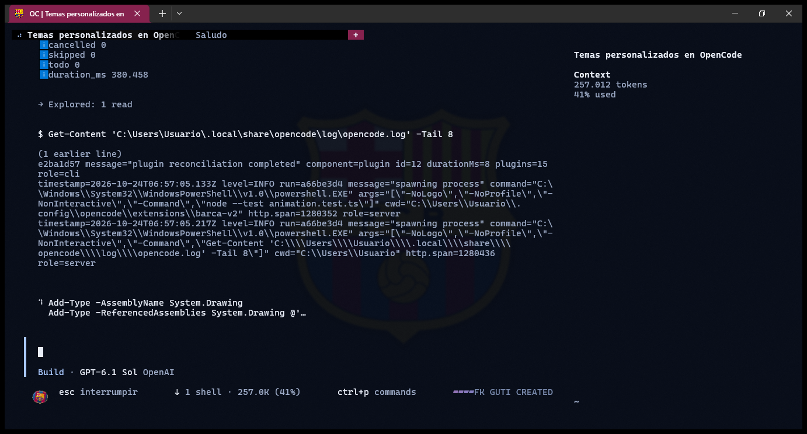

# Theme Barça para OpenCode

Tema no oficial **azulgrana** para [OpenCode](https://opencode.ai) 2.1.4+ (CLI V2 / OpenTUI): fondo azul noche, acentos azul y grana, efecto *Rainbow* con paleta del Barça, escudo de fondo y una pequeña **pelota animada** que sustituye al indicador de trabajo.

Creado por **FK GUTI**.



---

## Qué incluye

| Ruta | Contenido |
| --- | --- |
| `themes/barca.json` | Tema completo (modo oscuro) con superficies transparentes y diálogos opacos. |
| `extensions/barca-v2/` | Plugin de UI: saludo, pie, firma, pelota animada y comandos `/barca-*`. |
| `extensions/rainbow-v2/` | Adaptación local de Rainbow con paleta `barca` y modo solo acentos. |
| `config/cli.json` | Ejemplo de configuración global que activa el tema y los dos plugins. |
| `terminal/settings.json` | Perfil y esquema de color para Windows Terminal. |
| `screenshots/` | Captura de referencia. |

## Características

- **Paleta azulgrana**: azul noche `#080F20`, azul `#3975BD`, grana `#A52C60` y detalles dorados `#F3CB67`.
- **Fondo transparente**: deja ver la imagen del escudo; los paneles no tienen relleno y los diálogos usan una superficie sólida para seguir siendo legibles.
- **Sin recolorear el contenido**: el texto normal, los errores y los diffs mantienen sus colores semánticos.
- **Rainbow solo en acentos**: anima bordes y acentos entre azul y grana, sin tocar fondos ni prosa.
- **Pelota del Barça animada**: 32 sprites PNG con el escudo, movimiento suave a 10 fps, mostrada como imagen SIXEL (no pixel-art de bloques). Sustituye los puntos de "pensando" y mantiene `esc interrumpir`.
- **Marca de agua** discreta: `FK GUTI CREATED`.
- **Sin dependencias de terceros** y sin acceso a red: los plugins solo leen sus propios recursos.

## Requisitos

- **OpenCode 2.1.4 o superior** (la API de plugins TUI cambió en la V2).
- **Windows Terminal 1.25+** para ver la pelota como imagen. En terminales sin SIXEL el plugin no dibuja sustituto: es preferible no mostrar nada antes que un bloque de píxeles.
- **Node 24+** solo para ejecutar las pruebas.

## Instalación

1. Copia el contenido del repositorio dentro de tu configuración global:

   ```powershell
   $cfg = "$env:USERPROFILE\.config\opencode"
   New-Item -ItemType Directory -Force "$cfg\themes" | Out-Null
   Copy-Item .\themes\barca.json "$cfg\themes\barca.json"
   Copy-Item .\extensions\barca-v2  "$cfg\extensions\barca-v2"  -Recurse -Force
   Copy-Item .\extensions\rainbow-v2 "$cfg\extensions\rainbow-v2" -Recurse -Force
   ```

2. Fusiona `config/cli.json` con tu `~/.config/opencode/cli.json`. Lo esencial es:

   ```json
   {
     "theme": { "name": "barca", "mode": "dark" },
     "plugins": [
       {
         "package": "./extensions/rainbow-v2",
         "options": {
           "palette": "barca",
           "scope": "accents",
           "enabled": true,
           "fg": true,
           "bg": false,
           "speed": 0.004,
           "turns": 2,
           "glow": 0
         }
       },
       "./extensions/barca-v2"
     ]
   }
   ```

   Las rutas de los plugins son relativas al directorio de configuración.

3. Reinicia OpenCode. Si la interfaz no recoge los cambios, ejecuta `/reload`.

4. **Opcional — Windows Terminal**: copia `terminal/settings.json` sobre tu `settings.json` (o añade solo el esquema `Barca Night` y el perfil `OpenCode Barca`). Ajusta las rutas si tu usuario no es `%USERPROFILE%`. El perfil usa acrílico, opacidad 65 y el escudo precompuesto al 13 %.

## Comandos

| Comando | Efecto |
| --- | --- |
| `/barca-toggle` | Muestra u oculta los textos decorativos sin cambiar el tema. |
| `/barca-motion` | Pausa o reanuda la pelota; la firma permanece. |
| `/rainbow-toggle` | Activa o desactiva el efecto de color. |
| `/rainbow-settings` | Ajusta velocidad, bandas, brillo y primer plano/fondo. |

## Cómo está hecho

- **Tema**: JSON de OpenCode V2. `base.background.base`, `raised.base` y `raised.high` son `transparent`; `@dialog.background.base` es `#101C34` para que los diálogos se lean sobre el fondo.
- **Plugin de UI**: usa los *slots* de OpenCode (`context.ui.slot`) para el saludo, el pie y la firma. El indicador de trabajo se reemplaza con `replace: "prompt.footer.status"` y se vuelve a registrar al cambiar el estado de la sesión.
- **Pelota**: `make-football.ps1` compone 32 PNG de 128×96 con degradado azulgrana, bandas, borde dorado y el escudo. `NativeImage.load` los carga una sola vez y el plugin alterna fotogramas cada 100 ms. Al pausar, ocultar o descargar el plugin se detiene el temporizador y se liberan las imágenes.
- **Rainbow**: modifica los planos RGBA empaquetados de OpenTUI 0.6.8 respetando el canal alfa y limpiando el canal de intención; solo escribe en acentos y bordes.

## Personalización

- **Colores**: edita `themes/barca.json` (o los tonos de `extensions/rainbow-v2/effect.ts`).
- **Pelota**: cambia `width`/`height` del `<image>` en `extensions/barca-v2/tui.tsx` y el intervalo del temporizador.
- **Sprites**: coloca el escudo en `extensions/barca-v2/assets/barca-crest.png` y ejecuta:

  ```powershell
  .\extensions\barca-v2\make-football.ps1
  ```

- **Fondo**: `make-wallpaper.ps1` regenera `assets/barca-wallpaper.png` (1920×1080, escudo al 13 %).

## Pruebas

```powershell
cd extensions/barca-v2
node --test animation.test.ts

cd ..\rainbow-v2
node --test rainbow.test.ts
```

## Desinstalar

1. Quita `./extensions/barca-v2` y el objeto de `./extensions/rainbow-v2` de `plugins` en `cli.json`.
2. Cambia `theme.name` por otro tema (por ejemplo `matrix`).
3. Opcionalmente borra las carpetas copiadas. Nada se instala fuera de `~/.config/opencode` ni del perfil de Windows Terminal que crees.

## Aviso legal

Proyecto **no oficial**, sin relación con el FC Barcelona ni con OpenCode. El escudo, el nombre y los colores del club son marcas de sus propietarios; aquí se usan únicamente con fines decorativos personales. El código de este repositorio se distribuye bajo licencia MIT (ver `LICENSE`), que no cubre dichas marcas.

La adaptación de Rainbow está basada en el comportamiento de [oc-plugin-rainbow](https://github.com/anomalyco/oc-plugin-rainbow) (0.1.1); es una adaptación local para OpenCode V2, no una versión oficial de ese paquete.

---

Hecho con azul y grana por **FK GUTI**.
